# CareerAI
## Author

Developed by **Mugdha Manoj Kamble**

GitHub: https://github.com/Mugdha1502


#**Full-Stack AI-Powered Career Preparation and Real-Time Interview Platform**

CareerAI is a web application where students and freshers can practise coding, SQL and aptitude, take AI mock interviews (text and voice), work on their resume, and track their preparation in one place. It has a React frontend and a Spring Boot + MySQL backend.


---

## Table of Contents

1. [About the Project](#about-the-project)
2. [Main Features](#main-features)
3. [Technologies Used](#technologies-used)
4. [Screenshots](#screenshots)
5. [System Architecture](#system-architecture)
6. [Project Folder Structure](#project-folder-structure)
7. [How to Run Locally](#how-to-run-locally)
8. [Environment Variables](#environment-variables)
9. [Backend API Overview](#backend-api-overview)
10. [Testing](#testing)
11. [Current Project Status](#current-project-status)
12. [Future Improvements](#future-improvements)
13. [Project Context](#project-context)

---

## About the Project

CareerAI is a full-stack project I built to bring the main parts of placement and job preparation together. Instead of using one website for coding questions, another for SQL, a separate resume checker and something else for mock interviews, a user can do all of this from one account and see their progress on a single dashboard.

For students and freshers, a common problem is not knowing which skills are weak or what to practise next. CareerAI tries to address this by saving practice results, comparing the user's skills with a target role (Skill Gap), building a daily plan, and giving feedback after interviews and resume checks.

The website combines four areas: **practice** (technical, aptitude, coding, SQL, system design and more), **interview preparation** (text and real-time voice interviews with an AI interviewer), **resume tools** (builder, ATS analysis, job match and AI improvement) and **performance tracking** (history, analytics and a personal plan). There is also a FREE/PRO plan system with usage limits and Razorpay payments in Test Mode.

---

## Main Features

### User accounts
- Registration and login with passwords stored as BCrypt hashes
- JWT-based authentication (stateless API; the token is sent in the `Authorization` header)
- Onboarding form for current role, education, skills, target role and daily study time
- Profile and settings pages
- Guest mode for trying parts of the site without an account

### Dashboard
- Welcome section with the target role, XP level and daily streak
- Readiness cards, today's plan tasks and recommended practice
- Plan and usage card showing the current FREE/PRO limits

### Career preparation
- **Career Tracks** — roadmaps for six roles (Java Full Stack, Frontend, Backend, Full Stack, Python and .NET Developer) with topic pages
- **Skill Gap** — compares the skills a target role needs with the user's saved practice results and profile
- **My Plan** — daily preparation tasks that can be marked complete

### Practice modules
| Module | What it does |
|---|---|
| Technical Practice | Notes, quizzes and descriptive questions on programming topics |
| Aptitude | Timed quantitative, logical and verbal MCQs |
| Coding | Programming problems in a code editor (see below) |
| SQL Practice | Queries on practice datasets (see below) |
| System Design | Written answers to system design questions with a review |
| Voice Practice | Practise answering technical, HR and behavioural questions |
| Daily Challenge | A short mixed challenge each day |
| Mock Assessments | Timed recruitment-style tests across several areas |

Technical/aptitude questions and descriptive evaluation use Gemini through the backend when it is configured; otherwise built-in question sets are used and the result is labelled as a fallback. Results are saved for signed-in users.

### Coding practice
- Code editor with Java, Python, C++ and JavaScript starter code
- 10 curated problems (arrays, strings, linked lists, trees, dynamic programming and more)
- **Run Code** with custom input and **Submit** against hidden test cases
- Code is executed by the **JDoodle** API (Judge0 is supported as an optional alternative) — never inside the Spring Boot server
- On Submit, all hidden tests are combined into one execution, then scored; the score is saved to practice history

### SQL practice
- 16 questions on two practice datasets with a schema preview and sample rows
- Each query runs in a fresh, in-memory **H2** database — never against the application's MySQL database
- A statement guard blocks unsafe statements; timeouts and row limits apply
- **Run Query** shows the result table; **Submit** compares the result on visible and hidden data

### Resume tools
- **Resume Builder** with a live preview and saved versions (PDF export is not connected yet)
- Upload of PDF/DOCX resumes (text is extracted on the server)
- **ATS Analyzer** — rule-based scoring of structure, keywords, content and experience, with Gemini feedback when available
- **Job Match** — compares a resume with a job description
- **AI Resume Improvement** — suggests better wording (rule-based fallback without AI)
- **Resume Versions** and **Resume Interview Preparation** (questions based on a resume and job description)

### AI interview
- Interview setup: role-based, resume-based or job-based; technical, HR, behavioural or mixed; difficulty and length
- **Text interview** — AI-generated questions, answer evaluation and a final report
- **Real-time voice interview** using **Vapi** (the browser connects to Vapi with a public key; the microphone is used by the Vapi call)
- **Live transcript** during the voice interview; the transcript is sent to the backend for evaluation
- **Simli avatar** as an optional talking interviewer (see the status notes below)
- **Candidate camera** — an optional local self-view; the video is never recorded, uploaded or sent to Vapi or Simli
- Device check page before starting, and an interview report with scores and improvement areas

### AI Coach
- Chat-style career coach that uses the user's skill gap, plan and practice results
- Conversation history is saved

### Performance tracking
- Practice history and recent activity
- Performance dashboard with category scores, readiness trend and mock interview results
- Achievements/XP and an application tracker (these two are stored in the browser's `localStorage`)

### FREE/PRO subscription
- Daily and monthly usage limits per feature, enforced by the backend (`429 PLAN_LIMIT_REACHED`)
- Pricing page (₹299/month or ₹2,499/year), billing page with usage meters and payment history
- **Razorpay Test Mode**: the backend creates the order, verifies the payment signature and checks the payment with Razorpay before activating PRO
- Signed webhook handling with duplicate-event protection
- Expiry is checked on every request; buying again before expiry extends from the current end date, and buying after expiry starts a new period
- There is no auto-renewal

### Tested vs. still in progress

| Area | Status |
|---|---|
| Accounts, dashboard, practice, coding/SQL, resume tools, text interview, billing logic | Implemented and covered by backend tests or manual testing |
| Razorpay | Tested manually in **Test Mode** (successful, failed and cancelled checkout, webhooks, renewal). Live payments are **not** enabled |
| Vapi voice interview | Implemented; needs a Vapi public key and assistant configured |
| Simli avatar | Implemented, but it depends on the Simli service and account. When the session request fails (for example with HTTP 503), the voice interview continues with the built-in interviewer view |
| AI features | Need a Gemini API key; without it, fallback rules/content are used where possible |

---

## Technologies Used

### Frontend
| Technology | Purpose |
|---|---|
| React 19 | Building the user interface with components and hooks |
| JavaScript (JSX) | Language used for the frontend |
| Vite 8 | Development server and production build |
| React Router 7 | Page routing and protected routes |
| Axios | Calling the backend REST API, attaching the JWT |
| Recharts | Charts on the performance pages |
| React Icons | Icons |
| CSS | Custom styling (no UI framework) |
| Vapi Web SDK | Real-time voice interview in the browser |
| Simli Client | Avatar video stream in the browser |

### Backend
| Technology | Purpose |
|---|---|
| Java 21 | Backend language |
| Spring Boot 4.1 | REST API, configuration and dependency injection |
| Spring Security | Authentication filter, protected routes, CORS |
| JJWT 0.13 | Creating and validating JWT tokens |
| Spring Data JPA / Hibernate | Database access with entities and repositories |
| Bean Validation | Validating request data |
| Apache PDFBox and Apache POI | Reading uploaded PDF and DOCX resumes |
| Lombok | Reducing boilerplate code in entities |
| Maven (Maven Wrapper) | Build and dependency management |

### Database
| Technology | Purpose |
|---|---|
| MySQL 8 | Main application database |
| H2 (in-memory) | Disposable sandbox for SQL practice, and the database for backend tests |

### External services
| Service | Purpose | Called from |
|---|---|---|
| Google Gemini API | Interview questions and evaluation, AI coach, practice questions, resume analysis | Backend |
| Vapi | Real-time voice interviewer | Browser (public key) |
| Simli | Talking avatar | Backend creates a short-lived session; browser shows the stream |
| JDoodle | Running submitted code in a sandbox | Backend |
| Razorpay | Orders, payment verification and webhooks (Test Mode) | Backend + Razorpay Checkout in the browser |

### Developer tools
| Tool | Purpose |
|---|---|
| VS Code | Frontend development |
| Eclipse / Spring Tools | Running and debugging the Spring Boot backend |
| Git and GitHub | Version control and hosting the code |
| JUnit 5, MockMvc | Backend tests |
| Vitest, React Testing Library | Frontend tests for the subscription logic |
| ESLint | Frontend code checks |

---

## Screenshots

These screenshots were taken from the application running locally with a **demo account and sample data** (no real user data).

### Homepage

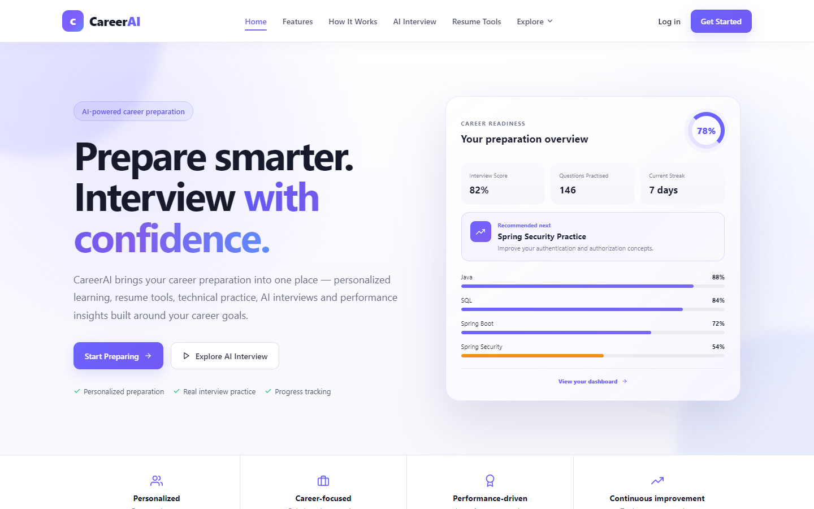

### Accounts and dashboard

<table>
  <tr>
    <td width="50%">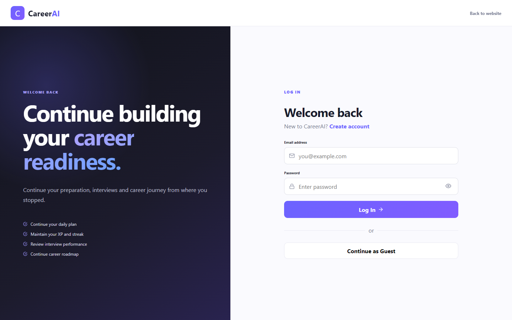<br><sub>Login</sub></td>
    <td width="50%">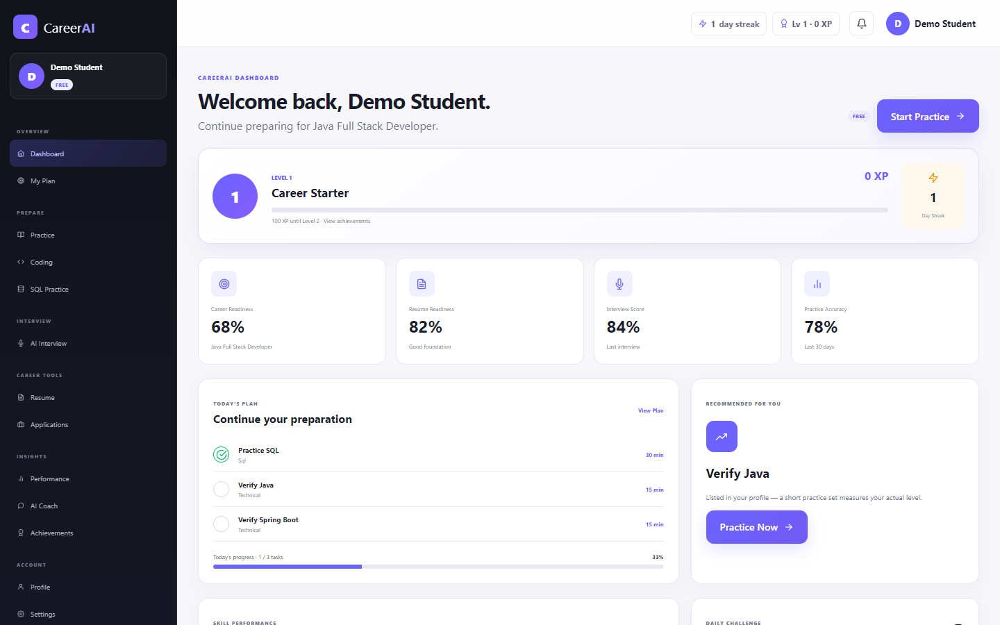<br><sub>User dashboard</sub></td>
  </tr>
</table>

### Practice

<table>
  <tr>
    <td width="50%">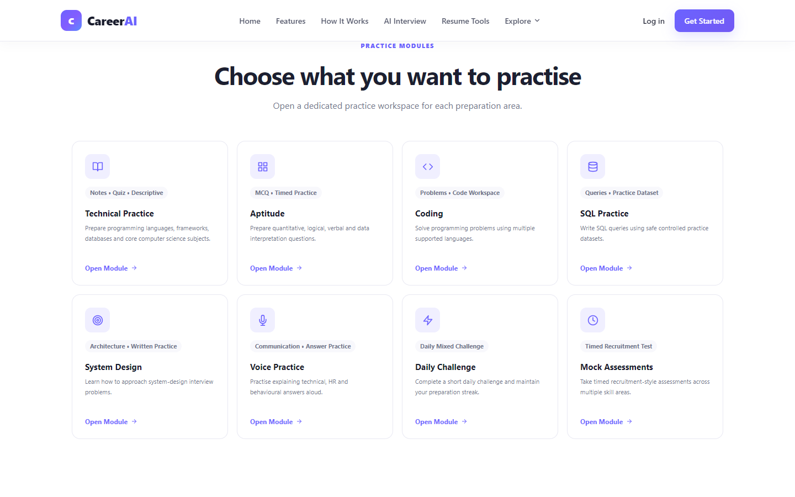<br><sub>Practice modules</sub></td>
    <td width="50%">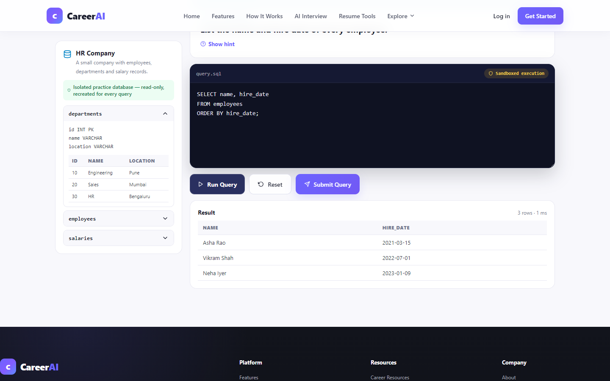<br><sub>SQL workspace — query result from the H2 sandbox</sub></td>
  </tr>
  <tr>
    <td width="50%">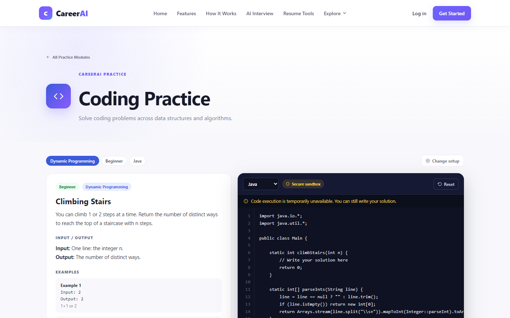<br><sub>Coding workspace (captured without JDoodle credentials, so the "execution unavailable" notice is shown)</sub></td>
    <td width="50%">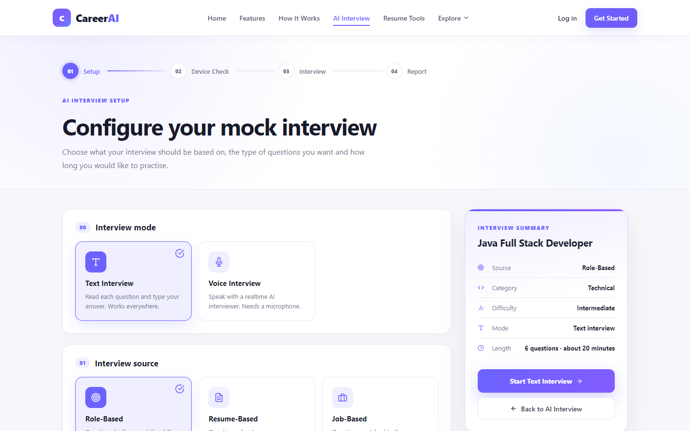<br><sub>AI interview setup</sub></td>
  </tr>
</table>

### Resume tools

<table>
  <tr>
    <td width="50%">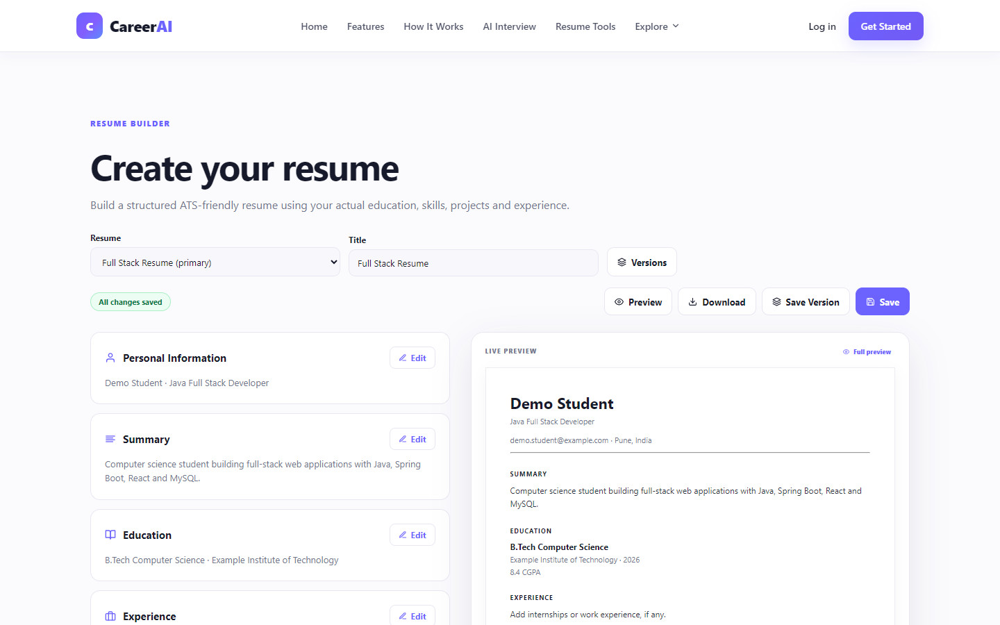<br><sub>Resume Builder with live preview</sub></td>
    <td width="50%">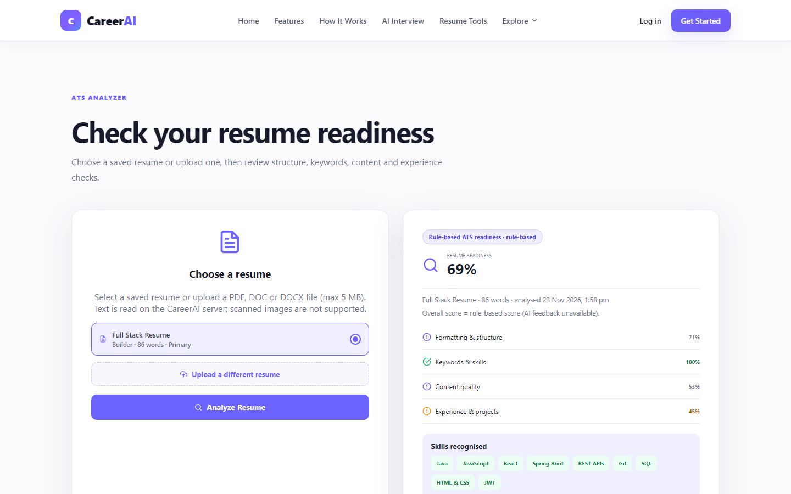<br><sub>ATS Analyzer (rule-based result)</sub></td>
  </tr>
</table>

### Coach and progress

<table>
  <tr>
    <td width="50%">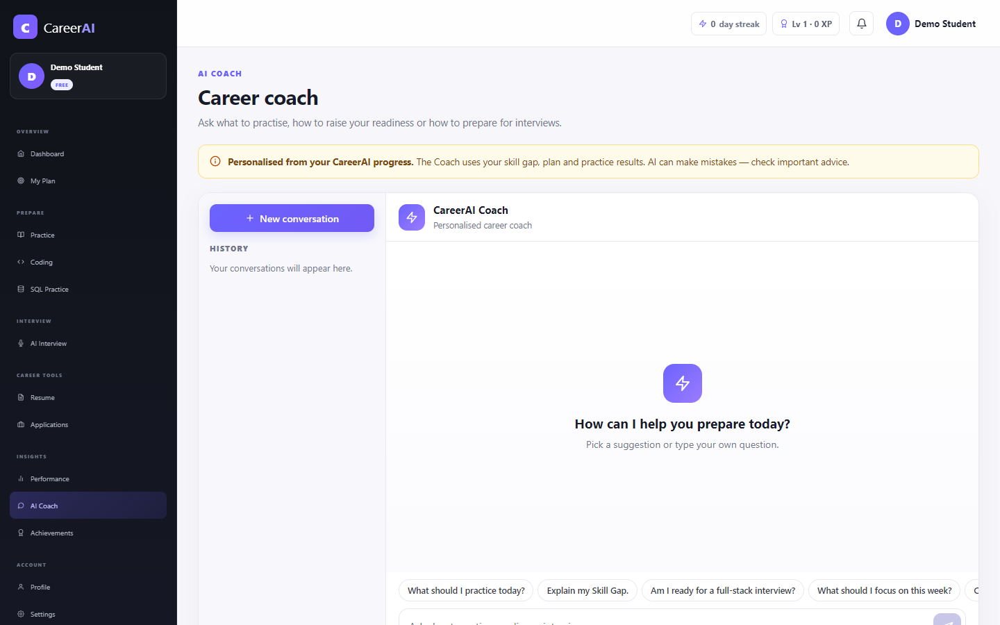<br><sub>AI Coach</sub></td>
    <td width="50%">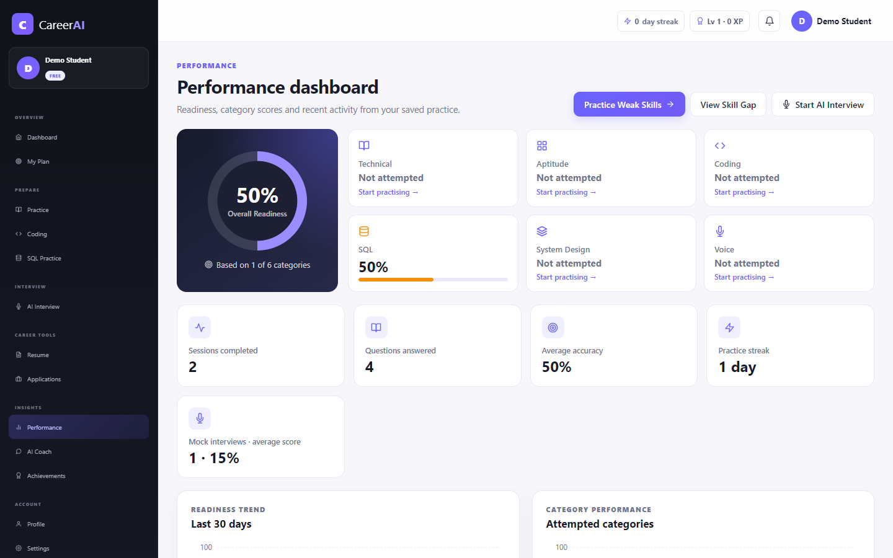<br><sub>Performance dashboard</sub></td>
  </tr>
  <tr>
    <td width="50%">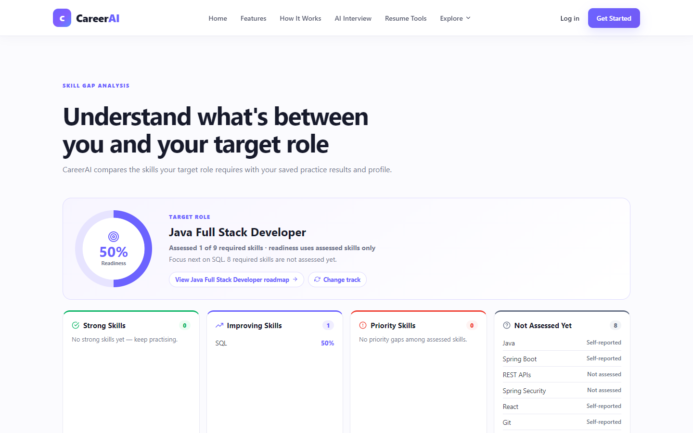<br><sub>Skill Gap analysis</sub></td>
    <td width="50%"></td>
  </tr>
</table>

### Plans and billing

<table>
  <tr>
    <td width="50%">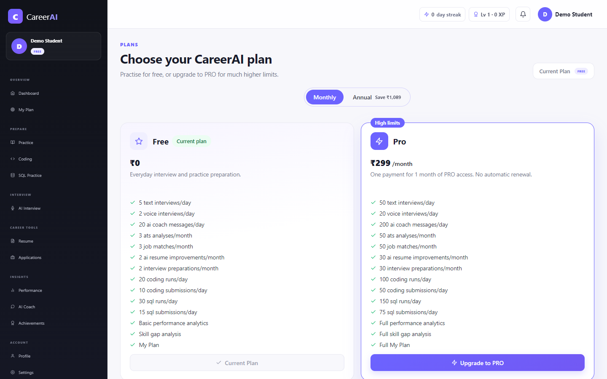<br><sub>Pricing (FREE and PRO limits)</sub></td>
    <td width="50%">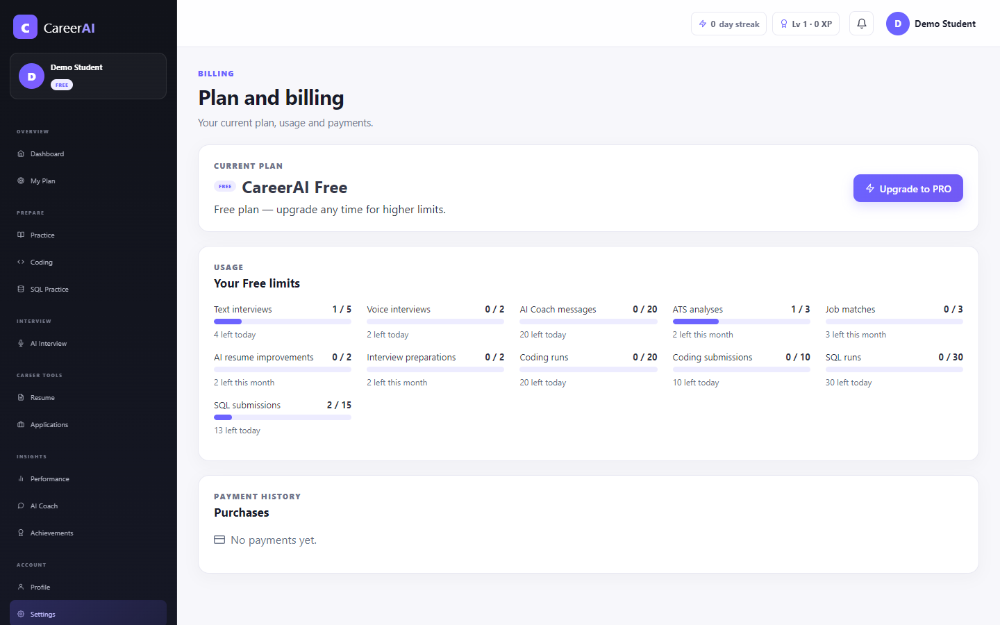<br><sub>Billing — usage and payment history</sub></td>
  </tr>
</table>

---

## System Architecture

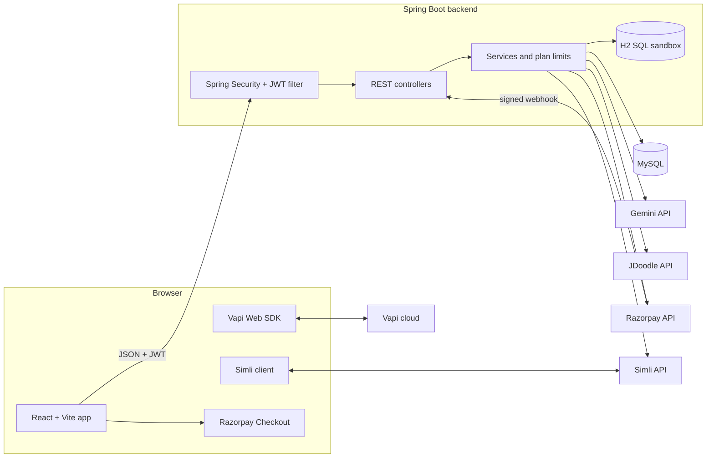

How a normal request works:

1. The React app calls the backend at `/api/...` and sends the JWT in the `Authorization: Bearer` header.
2. `JwtAuthenticationFilter` checks the token. The current user always comes from the token, never from the request body.
3. Controllers call services, which apply ownership checks and plan limits, then read or write MySQL through JPA repositories.
4. Services call external APIs where needed. **All secret keys (Gemini, Simli, JDoodle, Razorpay, database, JWT) stay on the backend.**

What runs where:

- **Backend only:** Gemini calls, code execution through JDoodle, the SQL sandbox, Razorpay order creation, payment verification and webhooks, and creating Simli sessions.
- **Browser:** the Vapi voice call (uses the Vapi *public* key), the Simli avatar stream (uses a short-lived token from the backend) and Razorpay Checkout (uses only the Razorpay key id).
- **Code is never executed on the Spring Boot server** — it is sent to JDoodle. SQL runs in a temporary in-memory H2 database, not in MySQL.

---

## Project Folder Structure

```
CareerAI/
├── frontend/                     React + Vite app
│   ├── src/
│   │   ├── pages/                Screens (auth, dashboard, practice, interview,
│   │   │                         resume, coach, performance, career, settings, subscription, public)
│   │   ├── components/           Reusable UI (billing, interview, resume, common, public)
│   │   ├── context/              AuthContext and SubscriptionProvider
│   │   ├── services/             API clients (api.js, auth, practice, interview, billing, vapi, simli ...)
│   │   ├── layouts/              Public layout and signed-in user layout (sidebar)
│   │   ├── routes/               AppRoutes
│   │   └── styles/               CSS files
│   ├── .env.example
│   ├── package.json
│   └── vite.config.js
├── careerai-backend/             Spring Boot backend
│   ├── src/main/java/com/careerai/backend/
│   │   ├── controller/           REST controllers
│   │   ├── service/              Business logic
│   │   ├── billing/              Plans, usage limits, Razorpay, subscriptions
│   │   ├── execution/            JDoodle / Judge0 code execution providers
│   │   ├── practice/             Question catalogs, hidden-test harness, SQL sandbox
│   │   ├── ai/                   Gemini provider and response parsing
│   │   ├── security/             JWT service and filter
│   │   ├── entity/  repository/  dto/  exception/  config/
│   ├── src/main/resources/
│   │   ├── application.properties
│   │   ├── application-local.properties.example
│   │   └── practice/             coding-questions.json, sql-questions.json
│   ├── src/test/                 JUnit tests (H2)
│   ├── .env.example
│   ├── pom.xml
│   └── mvnw, mvnw.cmd
├── docs/screenshots/             README screenshots
├── scripts/                      cleanup-test-data.sql (removes generated test users, dry run by default)
├── README.md
└── .gitignore
```

---

## How to Run Locally

### Prerequisites
- Java 21 (JDK)
- Node.js 20+ and npm
- MySQL 8 running on `localhost:3306`
- Git
- Maven is optional — the project includes the Maven Wrapper (`mvnw.cmd`)

### 1. Clone the repository

```powershell
git clone https://github.com/<your-username>/careerai-fullstack-ai-interview-platform.git
cd careerai-fullstack-ai-interview-platform
```

### 2. Configure MySQL

The backend connects to a database named `careerai` and creates it automatically if it does not exist (`createDatabaseIfNotExist=true`). Tables are created by Hibernate on startup.

Give the backend your MySQL password in **one** of these ways:

- set the `DB_PASSWORD` environment variable, or
- copy `careerai-backend/src/main/resources/application-local.properties.example` to `application-local.properties` in the same folder and fill in the password (this file is git-ignored).

### 3. Start the backend

**Option A — terminal (PowerShell):**

```powershell
cd careerai-backend
$env:DB_PASSWORD = "your-mysql-password"
.\mvnw.cmd spring-boot:run
```

**Option B — Eclipse / Spring Tools:** import `careerai-backend` as an existing Maven project, open *Run Configurations*, add the environment variables you need on the *Environment* tab, and run `CareeraiBackendApplication`.

The API runs on `http://localhost:8080`.

### 4. Start the frontend

```powershell
cd frontend
npm install
copy .env.example .env
npm run dev
```

Open `http://localhost:5173`, create an account and complete onboarding.

### Optional services

The core application works without any external API keys. Each optional service only enables its own feature:

| Without this key | What happens |
|---|---|
| `GEMINI_API_KEY` | AI endpoints return "unavailable"; ATS analysis and wording use rule-based fallbacks |
| `JDOODLE_CLIENT_ID` / `JDOODLE_CLIENT_SECRET` | You can write code, but Run/Submit show "execution unavailable" |
| `VITE_VAPI_PUBLIC_KEY` / `VITE_VAPI_ASSISTANT_ID` | Voice interview is shown as unavailable |
| `SIMLI_API_KEY` | Voice interview uses the built-in interviewer view |
| Razorpay keys | Plans are shown, checkout says payments are unavailable |

---

## Environment Variables

Templates: [`careerai-backend/.env.example`](careerai-backend/.env.example) and [`frontend/.env.example`](frontend/.env.example). Real values must never be committed — `.env` files and `application-local.properties` are in `.gitignore`.

### Backend

| Variable | Purpose | Required or Optional |
|---|---|---|
| `DB_URL` | JDBC URL (default: local `careerai` database) | Optional locally |
| `DB_USERNAME` | MySQL user (default `root`) | Optional locally |
| `DB_PASSWORD` | MySQL password | Required |
| `JWT_SECRET` | Secret for signing JWTs (32+ characters). The built-in value is only for local development | Required for any deployment |
| `JWT_EXPIRATION` | Token lifetime in ms (default 24 hours) | Optional |
| `CORS_ALLOWED_ORIGINS` | Allowed frontend origins (default `http://localhost:5173`) | Optional locally |
| `RESUME_STORAGE_DIR` | Folder for uploaded resumes (default `uploads/resumes`) | Optional |
| `GEMINI_API_KEY` | Gemini AI features | Optional |
| `GEMINI_MODEL` | Override the Gemini model | Optional |
| `SIMLI_API_KEY` | Simli avatar | Optional |
| `SIMLI_FACE_ID` | Simli face used for the interviewer | Optional |
| `CODE_EXECUTION_PROVIDER` | `jdoodle` (default), `judge0` or `none` | Optional |
| `JDOODLE_CLIENT_ID` | JDoodle API client id | Optional |
| `JDOODLE_CLIENT_SECRET` | JDoodle API client secret | Optional |
| `JUDGE0_BASE_URL`, `JUDGE0_API_KEY` | Only if using Judge0 instead of JDoodle | Optional |
| `RAZORPAY_KEY_ID` | Razorpay key id (Test Mode, `rzp_test_...`) | Optional |
| `RAZORPAY_KEY_SECRET` | Razorpay key secret (backend only) | Optional |
| `RAZORPAY_WEBHOOK_SECRET` | Secret used to verify Razorpay webhooks | Optional |
| `RAZORPAY_CURRENCY` | Currency (default `INR`) | Optional |

### Frontend

| Variable | Purpose | Required or Optional |
|---|---|---|
| `VITE_API_BASE_URL` | Backend URL (default `http://localhost:8080/api`) | Optional locally |
| `VITE_VAPI_PUBLIC_KEY` | Vapi **public** key | Optional |
| `VITE_VAPI_ASSISTANT_ID` | Vapi assistant id | Optional |

> Every `VITE_*` variable is included in the JavaScript bundle and can be seen by anyone, so only public values go there. Razorpay is used in **Test Mode** for development; no live keys are used.

---

## Backend API Overview

All routes are under `/api`. Except for register/login, the public plan list and the Razorpay webhook, every route needs a JWT.

| Area | Route prefix | Examples |
|---|---|---|
| Authentication | `/api/auth` | register, login, current user |
| Profile | `/api/profile` | get/update profile, onboarding |
| Practice | `/api/practice` | sessions, results, history, recent |
| AI practice | `/api/ai/practice` | AI questions, answer evaluation, system design review |
| Coding | `/api/practice/coding` | question, run code, submit |
| SQL | `/api/practice/sql` | question, run query, submit |
| Resumes | `/api/resumes` | upload, builder CRUD, versions, ATS analysis, job match, improvement, interview preparation |
| Interviews | `/api/interviews` | start, answer, voice transcript, complete, report, history, stats |
| Avatar | `/api/avatar` | create a Simli session |
| AI Coach | `/api/coach/conversations` | conversations and messages |
| Performance | `/api/performance` | summary, history, skills, recent activity |
| Skill Gap | `/api/skill-gap` | skill gap for the target role |
| My Plan | `/api/plan` | today's tasks, mark complete/incomplete |
| Billing | `/api/billing` | plans, current subscription, checkout order, verify, history, Razorpay webhook |

---

## Testing

### Backend (automated)
- **118 JUnit 5 tests** (latest run: 118 passed, 0 failed), run with:

  ```powershell
  cd careerai-backend
  .\mvnw.cmd test
  ```

- Tests use Spring Boot Test and MockMvc on an **in-memory H2 database**. A guard stops the tests from starting if they are pointed at a non-test database, so the normal `careerai` database is never touched.
- External services are replaced by local fakes: JDoodle, Judge0 and Razorpay are never called, so no credits or money are used.
- Covered areas include authentication, code execution providers, the hidden-test harness, the SQL sandbox, plan limits and concurrent usage, checkout and payment verification, webhooks (duplicates, forged signatures, out-of-order events) and subscription expiry/renewal.
- There is also an `integration` Spring profile that runs the backend against a separate `careerai_test` MySQL database for manual end-to-end checks.

### Frontend
- **Vitest + React Testing Library** tests for the subscription/plan-label logic (29 tests), run with `npm test`. These cover plan labels, expiry and refresh behaviour only — the rest of the frontend does not have automated tests yet.
- `npm run build` and `npm run lint` are used as checks. ESLint currently reports 2 known errors in older files (`AuthContext.jsx` and `AIInterview.jsx`).

### Manual testing
- Razorpay Checkout was tested in **Test Mode**: successful, failed and cancelled payments, `payment.captured` and `order.paid` webhooks, and two monthly purchases extending access correctly.

---

## Current Project Status

The project is **under development**. It runs locally and has not been deployed yet.

**Working:** accounts and JWT login, onboarding, dashboard, practice modules, coding (with JDoodle credentials) and SQL practice, resume tools, text interviews and reports, AI coach (with a Gemini key), performance and skill gap pages, FREE/PRO limits and Razorpay Test Mode payments.

**Known limitations:**
- Live Razorpay payments are **not** enabled; only Test Mode has been used.
- The Simli avatar depends on the Simli service and account; when a session cannot be created, the voice interview continues without the avatar.
- Voice interviews need a configured Vapi assistant and microphone access.
- Database tables are created by Hibernate (`ddl-auto=update`); there are no migration scripts yet.
- Uploaded resumes are stored on the local disk.
- Some features (application tracker, achievements/XP) store data only in the browser.
- The Resume Builder's PDF export button is not connected yet.
- External services have free-tier limits (for example, JDoodle's daily execution credits).

---

## Future Improvements

- Improve the reliability of real-time AI interview sessions (Vapi and Simli)
- Add more frontend automated tests and complete end-to-end tests
- Improve responsive layouts on smaller screens
- Add database migrations (Flyway) and cloud storage for resumes
- Deploy the complete application (frontend, backend and managed MySQL)
- Improve production monitoring and error handling
- Add more coding and SQL questions

---

## Project Context

**Developed as a full-stack web development project.**
